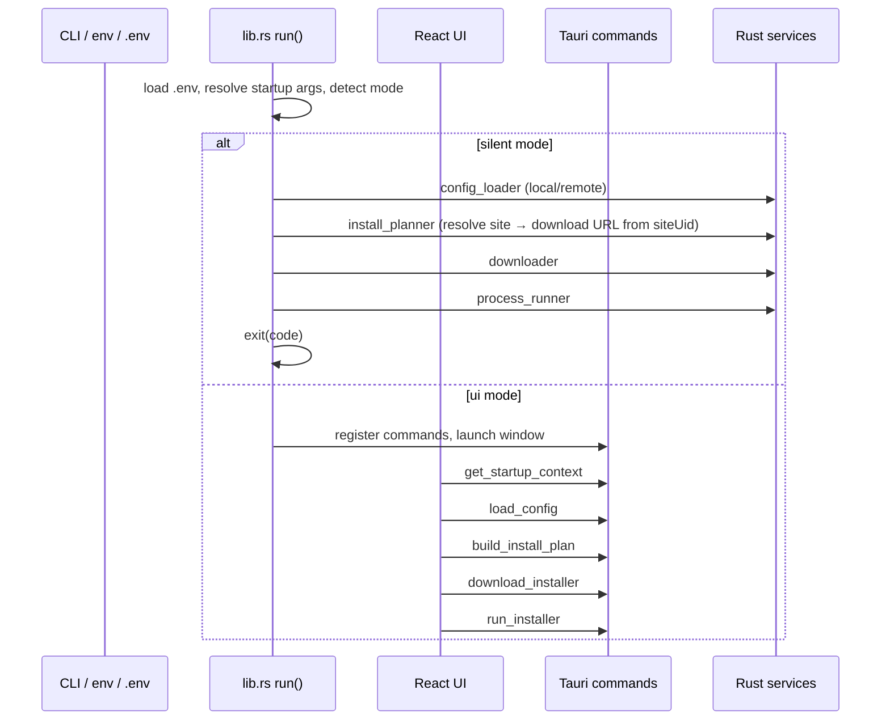

# FUNCTIONALITY.md

Implementation notes for datt-oh. Describes data flow, configuration, build/release packaging, and the behavior of each source module.

## Data Flow

The Rust backend is authoritative. The frontend never touches the filesystem, downloads, or process execution directly.

## Configuration

Precedence (highest first): CLI args → environment variables → `.env` → JSON config defaults → hardcoded safe defaults.

- **CLI parsing** (`services/arg_parser.rs`) accepts `/key=value`, `-key=value`, `/key value`, `-key value`, `/flag`, and quoted values. `siteId` is an alias for `site`; `/silent` implies `mode=silent`.
- **`.env` loading** (`services/logging.rs::load_dotenv`) tries `../.env`, `.env`, then `<exe-dir>/.env`.
- **JSON config** (`services/config_loader.rs`) loads a local path or HTTP(S) URL, parses with serde, and validates (non-empty `sites`, unique case-insensitive `id`, non-empty `siteUid` limited to letters/digits/`-`).

## Window behavior

- Log panel height: in the two-column layout the log is absolutely positioned inside its grid cell (`lg:absolute lg:inset-0`), so the row height is set only by the Site + Status column and the log panel matches it exactly; its content scrolls and `LogPanel` auto-scrolls to the newest entry. In the single-column layout it falls back to a `max-h-96` scroll area.
- The native window title starts as `datt-oh` (`tauri.conf.json`) and is replaced by `app.title` from the config once it loads (`setWindowTitle` in `src/lib/tauri.ts`, called from the installer store).
- `AppShell` observes its root element with a `ResizeObserver` and calls `fitWindowHeight` so the window's inner height always matches the content (capped to the screen's available height; width is left to the user). The root deliberately has no `min-h-screen`, otherwise the content would stretch to the window and the fit would feed back. `tauri.conf.json` sets a small `minHeight` (300) so the window can shrink.
- The native title bar is disabled (`"decorations": false` in `tauri.conf.json`). `data-tauri-drag-region` is set on `html`, `body`, `#root` (so any empty space revealed when the window is resized taller than the content still drags), the page root, header, `main`, the action row, and the footer so dragging any background area moves the window (the attribute is not inherited, so cards and controls do not drag; the header's logo/title/badge use `pointer-events-none` so clicks fall through to the header).
- `WindowControls` (in `src/components/WindowControls.tsx`) renders the right-aligned traffic lights — green maximize/restore, yellow minimize, red close — via `toggleMaximizeWindow`, `minimizeWindow`, and `closeWindow` in `src/lib/tauri.ts`. `fitWindowHeight` skips fitting while the window is maximized so it does not un-maximize it.
- While maximized, background drags are blocked so the window cannot be dragged (which would un-maximize it on Windows): `AppShell` tracks the maximized state via `watchMaximized` (initial `isMaximized()` + `onResized`), and a capture-phase `mousedown` listener on `window` stops the event before Tauri's `document` drag handler when the target has `data-tauri-drag-region`. Double-click is handled there too and calls `toggleMaximizeWindow`. Normal (non-maximized) dragging is untouched.
- Keyboard shortcuts (a `keydown` listener in `AppShell`): `F11` calls `toggleMaximizeWindow`; `Esc` calls `restoreIfMaximized` (un-maximizes) (no-op when not maximized, and ignored when the event comes from the site `<select>`, where Esc closes the dropdown). Key repeat is ignored.
- Permissions required in `src-tauri/capabilities/default.json`: `core:window:allow-set-title`, `allow-set-size`, `allow-start-dragging`, `allow-close`, `allow-minimize`, `allow-toggle-maximize`, `allow-unmaximize`, `allow-is-maximized`.

## Build and release packaging

- Frontend: `npm run build` runs `tsc` then `vite build`, emitting to `dist/`.
- Backend: `cargo build` via `tauri build`. `build.rs` invokes `tauri_build::build()`.
- `src-tauri/tauri.conf.json` wires `devUrl` (dev server) and `frontendDist: ../dist` (production).
- `crate-type = ["lib", "staticlib"]` — `cdylib` is intentionally omitted because it triggers the GNU linker's export-ordinal limit on Windows.
- Branding lives in `resources/`: `logo.webp` (square) is the header logo, favicon, and source for `npx tauri icon resources/logo.webp`, which generates the icons in `src-tauri/icons/`; `logo.ico` is then copied over `src-tauri/icons/icon.ico`. This is automated by `scripts/tauri.mjs` (the `tauri` npm script): on `dev`/`build` it hashes both logo files, compares against `src-tauri/target/.logo-hash`, and when they differ regenerates the icons, copies the `.ico`, and runs `cargo clean -p datt-oh` (Cargo does not detect icon-only changes because `generate_context!()` embeds them). `npm run sync` runs the version and icon steps without launching Tauri.
- The release binary uses `windows_subsystem = "windows"` (no console window).
- Versioning: `src-tauri/Cargo.toml` `package.version` is the single source of truth. `tauri.conf.json` omits `version`, so Tauri falls back to Cargo's for the bundle and for `getVersion()` (shown in the UI header badge). `scripts/tauri.mjs` (`syncVersion`) copies that version into `package.json` and the two root entries of `package-lock.json` on every `dev`/`build` (and `npm run sync`), using targeted text replacement so formatting is untouched. `package.json`'s version is therefore an output, never an input.

## main.rs

Binary entry point.

- `#![cfg_attr(not(debug_assertions), windows_subsystem = "windows")]` hides the console in release.
- `fn main()` delegates to `datt_oh_lib::run()`.

## lib.rs

Library entry point and orchestration.

- **`AppState`** — managed Tauri state holding `startup: StartupArgs`, `config_source: Option<String>`, `log_path: String`.
- **`run()`** — loads `.env`, resolves startup args, determines mode, and branches:
  - silent → `run_silent` then `std::process::exit(code)`
  - ui → builds the `tauri::Builder` with `.manage(state)` and the registered command handler.
- **`run_silent` / `run_silent_async`** — the silent install flow: load config → resolve site (case-insensitive, with config default fallback) → build plan → download → run → map result to an exit code. Exit codes follow the `AppError::exit_code` table plus `0` for success.

## commands/

Tauri `#[tauri::command]` surface.

### `config.rs`

- `get_startup_context` → `StartupContext` (mode, config source, overrides, log path).
- `load_config` → `AppConfig` (validated).

### `installer.rs`

- `download_installer(url, save_path)` → `DownloadResult`.
- `run_installer(save_path, args, success_codes)` → `InstallResult`.
- `build_install_plan(state, request)` → `InstallPlan` (validates before any download).
- `install_agent(state, request)` → `InstallResult` (high-level: plan + download + run).
- `load_state_config` helper reloads config from the resolved `config_source`.

## services/

### `arg_parser.rs`

- `parse_args` — Windows-style arg tokenizer (key/value, flags, quoted values).
- `resolve_startup` — merges CLI and env into `StartupArgs`.
- `default_config_source` — first existing of `../config.json`, `config.json`, `./config.json`.
- `default_log_path` — `%ProgramData%\datt-oh\logs\installer.log`.

### `config_loader.rs`

- `load_config` — local file or HTTP(S) URL → `AppConfig`.
- `validate_config` — non-empty sites, unique ids, non-empty site UIDs.

### `downloader.rs`

- `download_installer` — creates parent dirs, streams the body to the destination, rejects zero-byte files, returns size/duration.

### `process_runner.rs`

- `run_installer` — verifies the file exists, runs it directly via `tokio::process::Command` (no shell), captures stdout/stderr and exit code, and treats configured success codes (default `[0, 3010]`) as success.

### `install_planner.rs`

- `build_install_plan` — resolves the site by id, validates the site UID (`is_valid_site_uid`: letters, digits, `-`), builds the download URL (an `installerUrl` override wins; otherwise `installer.downloadUrlTemplate` or `DEFAULT_DOWNLOAD_URL_TEMPLATE`, with the platform from override → `installer.platform`, else `PlatformMissing`), then appends raw extra args (deduplicated). No site argument is passed to the installer; the site binding lives in the download URL.
- `apply_template` — substitutes `{{platform}}`, `{{siteUid}}`, `{{id}}`, `{{shortName}}`, `{{displayName}}`.
- `is_valid_site_uid` / `is_valid_platform` — character allow-lists, since both values are placed in a URL.
- Unit tests cover default template expansion, missing platform, and unsafe site UIDs.

### `logging.rs`

- `load_dotenv` — loads `.env` from candidate sites.
- `write_log` — appends a timestamped, leveled line to the log file (creating parents).
- `redact_args` / `redact_arg` — masks values whose key contains a sensitive token (password/secret/token/key/apikey/auth/credential).
- `timestamp` / `civil_from_days` — dependency-free UTC ISO-8601 timestamp.

## models/

### `models/config.rs`

`AppConfig`, `AppSection` (`title`, `subtitle`, `theme`), `InstallerSection`, `DefaultsSection`, `SiteConfig`, `AppMode`. JSON uses camelCase keys (`platform`, `downloadUrlTemplate`, `siteUid`, etc.).

### `errors.rs`

`AppError` (thiserror) with `category()`, `exit_code()`, and a manual `Serialize` impl emitting `{ category, detail }` for the frontend. `ErrorCategory` enumerates config/validation/download/filesystem/installer/argument/site/network/unknown.

### `models/installer.rs`

DTOs for the Tauri boundary: `StartupContext`, `InstallRequest`, `InstallPlan`, `DownloadResult`, `InstallResult` (all `camelCase`).

### `models/startup.rs`

`StartupArgs` — resolved CLI/env startup values.

## Target software

| installed_name | osd_description    | detection function                                              |
| -------------- | ------------------ | --------------------------------------------------------------- |
| Datto agent    | Datto RMM agent    | Site-specific installer download (`siteUid` in URL) + execution |
