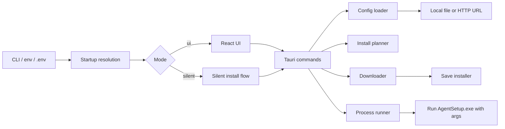

# datt-oh

A Windows desktop app for installing the **Datto RMM agent**. Choose a customer site in a polished UI, then download and run the Datto installer — or drive the whole thing from the command line in silent mode.

Built with **Tauri v2**, **React**, **TypeScript**, **Vite**, **Tailwind CSS v4**, **daisyUI v5**, and a **Rust** backend.

## Prerequisites

- [Node.js](https://nodejs.org/) (npm)
- [Rust](https://www.rust-lang.org/tools/install) (stable toolchain)
- Tauri system prerequisites for Windows:
  - Microsoft C++ Build Tools (MSVC) or a MinGW-w64 GNU toolchain
  - [WebView2 Runtime](https://developer.microsoft.com/microsoft-edge/webview2/) (preinstalled on Windows 11)

## Building

```sh
npm install          # install frontend dependencies
npm run tauri dev    # run in development (hot reload)
npm run tauri build  # produce a production Windows bundle
npm run typecheck    # TypeScript-only check (tsc --noEmit)
npm run sync         # sync version + app icons without building
```

`npm run tauri dev` and `npm run tauri build` first copy the version from `src-tauri/Cargo.toml` into `package.json`/`package-lock.json`, then automatically regenerate the app icons from `resources/logo.webp` / `resources/logo.ico` and clear the cached app build when either file changes (unchanged logos are skipped). `logo.webp` must be square.

## Configuration

Configuration is resolved from several sources, in this order of precedence:

1. CLI arguments
2. Environment variables
3. `.env`
4. JSON config defaults
5. Hardcoded safe defaults

### Environment variables

| Variable        | Purpose                                                                        |
| --------------- | ------------------------------------------------------------------------------ |
| `MODE`          | `ui` or `silent`                                                               |
| `SILENT`        | `1`/`true`/`yes` enables silent mode                                           |
| `CONFIG`        | Local path or web URL to the JSON config                                       |
| `INSTALLER_URL` | URL to download the Datto installer from                                       |
| `SAVE_PATH`     | Full local path where the installer should be saved                            |
| `SITE`          | Site ID from the config `sites` array                                          |
| `SITE_ID`       | Alias for `SITE`                                                               |
| `SITE_UID`      | Optional site UID override (replaces the config site's `siteUid`)              |
| `PLATFORM`      | Datto RMM platform subdomain (e.g. `concord`); overrides `installer.platform`  |
| `EXTRA_ARGS`    | Optional raw installer args (whitespace-separated)                             |
| `LOG_PATH`      | Optional custom log file path                                                  |

Copy `.env.example` to `.env` and adjust as needed.

### JSON config

The JSON config may be a local file or an HTTP(S) URL. See `config.json` for a complete example. The `app` section sets the header branding (and the window title): `title` and `subtitle`; a missing `subtitle` is simply not shown. The footer credit is hardcoded in the UI. The `v<version>` header badge is not configurable — it is read from the built app (`version` in `src-tauri/Cargo.toml`, the single source of truth — `tauri.conf.json` deliberately has no `version`, and `package.json` is overwritten from it on every dev/build, so never edit its version by hand) so it always matches the binary. Sites are customer/site objects; the selected site's `siteUid` (the UID Datto RMM assigns to the site) is substituted into the agent download URL, which is what ties the installed agent to that site.

The download URL comes from `installer.downloadUrlTemplate` (default `https://{{platform}}.rmm.datto.com/download-agent/windows/{{siteUid}}`), with `{{platform}}` taken from `installer.platform`, `PLATFORM`, or `/platform`. `/installerUrl` bypasses the template entirely. Verify the template against the agent download link shown in your own Datto RMM site settings, since the format can differ per platform/region.

The Datto agent installer needs no site argument, so the app passes none; the only way to supply installer switches is the raw `/extraArgs` CLI/env value. `installer.successExitCodes` (default `[0, 3010]`) lists exit codes treated as success.

## Usage

### UI mode

```sh
datt-oh.exe
datt-oh.exe /config=https://example.com/datto-config.json
```

Shows the main window (titled from `app.title` in the config, automatically sized to fit its content, and frameless: drag any background area to move it, and use the green/yellow/red buttons at the top right to maximize, minimize, or close; `F11` toggles maximize, and `Esc` restores the window while maximized) with a site dropdown (starting on a `----------` placeholder, so the Install Agent button stays disabled until a valid site is chosen; `defaults.siteId` pre-selects a site) and status on the left and a live log panel on the right.

### Silent mode

```sh
datt-oh.exe /silent /site=77FORT /config=./config.json
datt-oh.exe -silent -site 77FORT -config C:\Path\config.json
datt-oh.exe /mode=silent /site=77FORT
```

Silent mode never shows a window. It resolves the site, downloads the installer, runs it, writes a log, and exits with a meaningful code.

### CLI arguments

Both `/arg` and `-arg` styles are supported, with `=value` or space-separated values, including quoted paths:

```powershell
/silent | -silent
/mode=ui | -mode=silent
/config=path-or-url | -config "C:\Path\config.json"
/installerUrl=https://concord.rmm.datto.com/download-agent/windows/<siteUid>
/savePath="C:\ProgramData\datt-oh\DattoAgent\AgentSetup.exe"
/site=77FORT | -siteId 77FORT
/platform=concord
/siteUid=00000000-0000-0000-0000-000000000001
/extraArgs="<raw installer args>"
/logPath="C:\ProgramData\datt-oh\logs\installer.log"
```

## Generating the site list

`npm run sites` (alias `npm run configurator`) pulls every site from the Datto RMM API and writes `sites.json` in the repo root, then prints the file's full path. It is a developer tool and is not part of the app; the output is gitignored because it holds real customer data. Copy its `sites` array into `config.json`.

Anything not set in the environment or `.env` is asked for in the terminal: `DATTO_API_KEY`, `DATTO_API_SECRET` (typed hidden) and the platform. Create the keys in Datto RMM under Setup > Users > your user > API Access. The platform is set by `--platform` or `PLATFORM`; if neither is set it is asked for, defaulting to `installer.platform` from `config.json` (press Enter to accept). Give a short name like `vidal` to use `https://vidal-api.centrastage.net`, or a full `http(s)://` URL to use it as given. With no terminal (for example when piped) a missing value is an error instead of a prompt. `--out <file>` (or `SITES_OUT`) changes the output path. Requires Node 22.18 or newer, which runs the TypeScript script directly.

Datto sites only have a name, so a name is split into short name and display name at its first spaced dash (` - `, ` – `, ` — `), colon, or semicolon (`77FORT - Fortress Security`, `77FORT: Fortress Security`); an unspaced hyphen like `Coca-Cola` is not a delimiter. A name with no delimiter is used as both. Ids come from the short name (a `-2` suffix is added on collision), sites are sorted by short name, the built-in "Deleted Devices" site is skipped, and a site with no name is called `Site <first 8 chars of its UID>`. Review the result before using it.

## Output

- **UI mode** logs progress to an on-screen log panel.
- **Silent mode** writes to the log file and exits with a code.

Default log path: `C:\ProgramData\datt-oh\logs\installer.log`

### Silent-mode exit codes

| Code | Meaning                                            |
| ---: | -------------------------------------------------- |
|  `0` | Success                                            |
|  `2` | Config path missing, or config load failed         |
|  `3` | Config invalid                                     |
|  `5` | File-system error                                  |
|  `6` | Missing required input (site, URL, or save path)   |
|  `7` | Invalid site, or empty site UID                    |
|  `8` | Download/network failure                           |
|  `9` | Installer failed (or its non-success exit code)    |

## Architecture



The **Rust backend is authoritative** for config loading, filesystem access, downloading, installer execution, and logging. The frontend never runs the installer directly.

## Modules

### Frontend (`src/`)

- `App.tsx`, `main.tsx` — entry point and provider wiring
- `components/` — `AppShell`, `Header`, `SiteSelect`, `InstallerStatus`, `InstallButton`, `LogPanel`, `ErrorPanel`
- `lib/` — `types`, `tauri` (command wrappers), `config`, `validation`, `installerArgs`, `errors`
- `state/installerStore` — React context + state machine
- `styles.css` — warpburple theme (Tailwind v4 + daisyUI v5)

### Backend (`src-tauri/src/`)

- `main.rs` — binary entry point
- `lib.rs` — silent-mode flow + Tauri builder
- `commands/` — `config`, `installer`
- `services/` — `arg_parser`, `config_loader`, `downloader`, `install_planner`, `process_runner`, `logging`
- `models/` — `config`, `installer`, `errors`, `startup`

## Tracked Software

| installed_name | osd_description    | detection function                                              |
| -------------- | ------------------ | --------------------------------------------------------------- |
| Datto agent    | Datto RMM agent    | Site-specific installer download (`siteUid` in URL) + execution |
